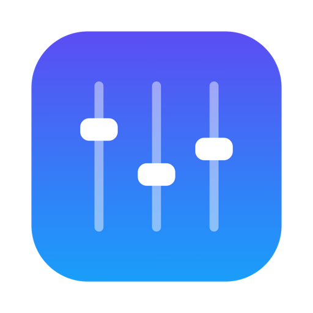
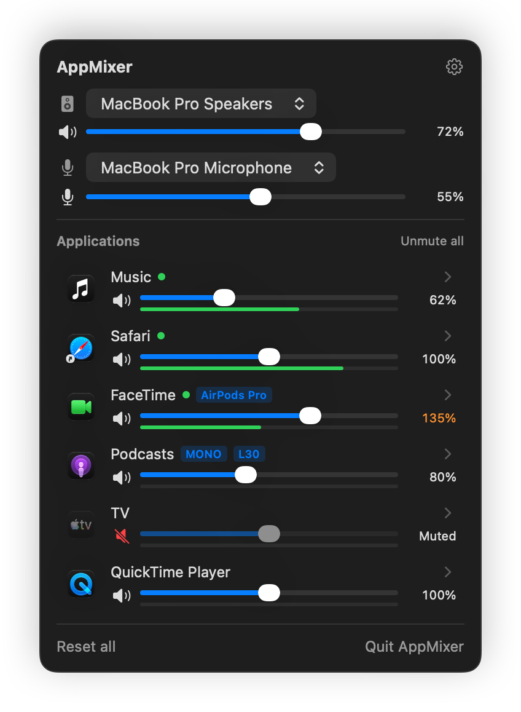
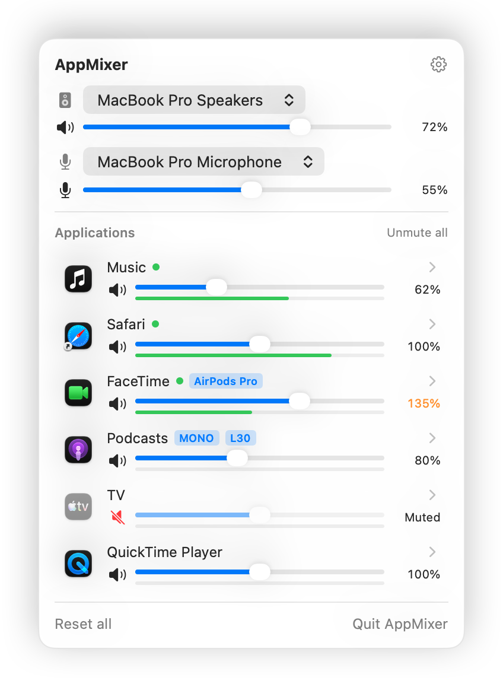
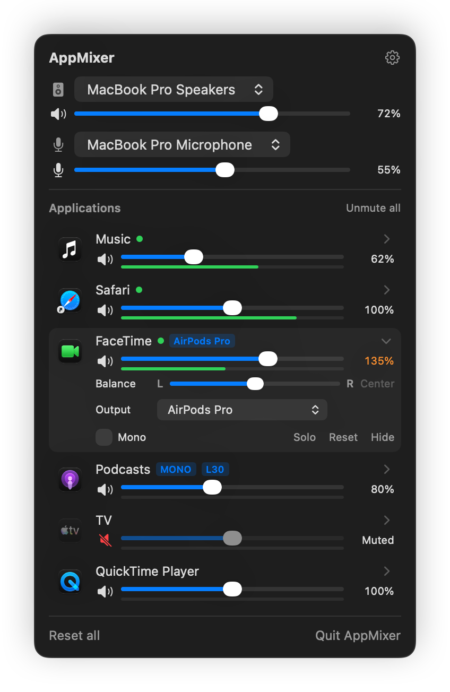
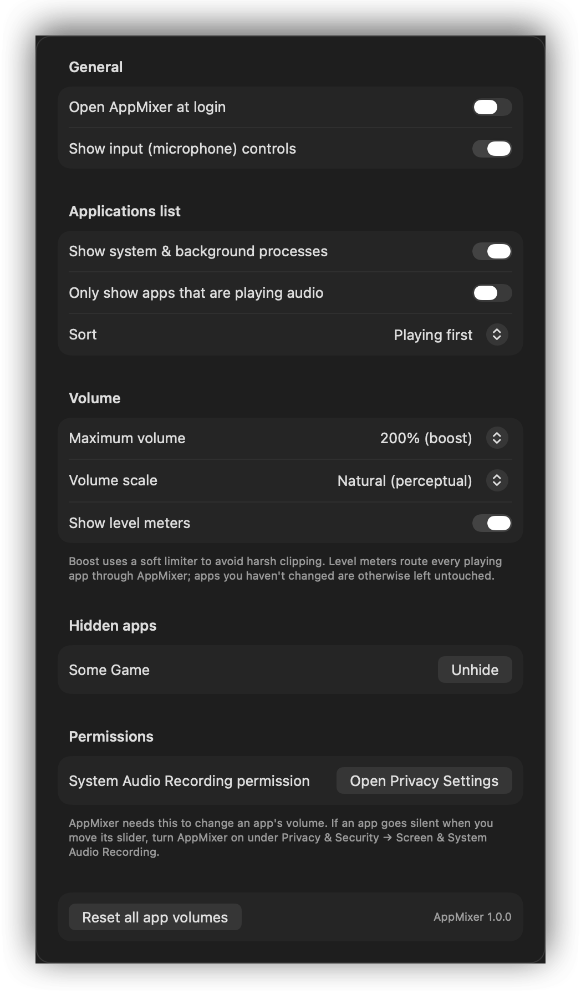

<p align="center">
  
</p>

<h1 align="center">AppMixer</h1>

<p align="center">
  <b>Per-app volume control for macOS, like the Windows volume mixer.</b><br>
  Turn down one app, boost another, send a third to your headphones, all from the menu bar.
</p>

<p align="center">
  <a href="../../releases/latest"></a>
  
  
  
</p>

<p align="center">
  
  
</p>

---

## Features

**Per-app controls**
- 🎚️ **Volume slider for every app**, from 0% up to **200% boost** (with a soft limiter so it doesn't distort harshly)
- 🔇 **Mute** and **Solo** (mute everything else)
- ↔️ **Left / right balance**
- 🎧 **Per-app output device**: send Music to your speakers and FaceTime to your AirPods
- 🔈 **Mono** downmix
- 📊 **Live level meters**
- 🙈 **Hide** apps you never want to see
- 💾 Settings are **remembered per app**, and come back the next time it opens

**System controls**
- Switch the **output and input device** right from the menu bar
- **Master volume and mute** for speakers and microphone

**Smart behavior**
- Apps at 100% are **left completely untouched**: no processing, no added latency
- Browser tabs and helper processes are **grouped under their app** (Safari, Chrome, Electron apps…)
- Follows you when you **switch output devices** or plug in headphones
- Native SwiftUI menu bar app, light & dark mode, tiny and fast

<p align="center">
  
  
</p>

## Install

1. Download **`AppMixer-x.y.z.dmg`** from the [latest release](../../releases/latest).
2. Open it and drag **AppMixer** into **Applications**.
3. Open AppMixer. Because it isn't notarized by Apple, macOS will block it the first time:
   - Go to **System Settings → Privacy & Security**, scroll down and click **Open Anyway**, **or**
   - run this once in Terminal:
     ```sh
     xattr -dr com.apple.quarantine /Applications/AppMixer.app
     ```
4. Click the **slider icon** in the menu bar.
5. The first time you change an app's volume, macOS asks for **System Audio Recording** permission. Click **Allow**.

> **Requires macOS 15 Sequoia or later.** Works on Apple Silicon and Intel Macs.

## Usage

| Action | How |
|---|---|
| Change an app's volume | Drag its slider. It snaps to 100% near the middle so you can easily return to "untouched". |
| Mute / unmute | Click the speaker icon next to the slider |
| Balance, output device, mono, solo, hide | Click the **›** arrow on the app's row, or right-click the app |
| Boost above 100% | Settings → **Maximum volume** → 150% or 200% |
| Show level meters | Settings → **Show level meters** |
| Start at login | Settings → **Open AppMixer at login** |
| Bring back a hidden app | Settings → **Hidden apps** → Unhide |
| Open Settings | Gear icon, or **⌘,** while the mixer is open |

### All settings

| Setting | What it does |
|---|---|
| Open AppMixer at login | Launches AppMixer automatically when you log in |
| Show input (microphone) controls | Shows the input device picker and mic level in the mixer |
| Show system & background processes | Lists non-app processes (e.g. system sounds) while they play audio |
| Only show apps that are playing audio | Hides idle apps (apps you've customised always stay visible) |
| Sort | *Playing first* or *Alphabetical* |
| Maximum volume | 100%, 150% or 200% |
| Volume scale | *Natural* (perceptual, like most volume controls) or *Linear* |
| Show level meters | Live meters under each slider (routes every playing app through AppMixer) |

## How it works

AppMixer uses **Core Audio process taps** (`CATapDescription` / `AudioHardwareCreateProcessTap`), the API Apple added in macOS 14.2 for capturing audio from individual apps. No kernel extensions, virtual audio drivers or system modifications are involved.

```
           ┌──────────────┐   original output muted
  App ───► │ process tap  │ ─────────────────────────✕
           └──────┬───────┘
                  ▼
     private aggregate device (tap + output device)
                  │   × volume, balance, mono, limiter
                  ▼
           🔊 speakers / headphones
```

For each app whose settings differ from the default, AppMixer:

1. Creates a **private process tap** for that app's processes and mutes the original output.
2. Creates a **private aggregate device** combining the tap with the chosen output device.
3. Plays the audio back through a real-time callback that applies volume, balance, mono and a soft limiter (only when boosting), with gain ramping to avoid clicks.

When you put an app back to 100%, its tap is torn down and the app plays directly again. Taps are private to AppMixer and disappear automatically if it quits.

## Build from source

Requires Xcode (or the Command Line Tools) with Swift 6 and the macOS 15+ SDK.

```sh
git clone https://github.com/ItzSudhan/AppMixer.git
cd AppMixer
./build.sh              # builds build/AppMixer.app (universal)
./build.sh install      # builds, copies to /Applications and launches
./build.sh dmg          # builds build/AppMixer-<version>.dmg
./build.sh screenshots  # re-renders the README screenshots with demo data
```

No Xcode project is needed; the script calls `swiftc` directly.

### Project layout

```
Sources/
  MixerApp.swift           App entry point, menu bar extra, settings window
  MixerView.swift          Menu bar mixer UI (device section, app rows, meters)
  SettingsView.swift       Settings window
  Mixer.swift              App discovery, grouping, settings, tap management
  AppTap.swift             Process tap + aggregate device + real-time audio rendering
  CoreAudioUtils.swift     Core Audio property helpers, devices, volume
  ScreenshotRenderer.swift Renders README screenshots with demo data
Resources/AppIcon.icns     App icon
Tools/make_icon.swift      Generates the app icon
```

## Troubleshooting

**An app goes silent when I move its slider.**
AppMixer doesn't have audio capture permission. Open **System Settings → Privacy & Security → Screen & System Audio Recording** and enable AppMixer (Settings → *Open Privacy Settings* takes you there). If you rebuilt the app yourself, remove and re-add it, because each ad-hoc build has a new signature.

**"AppMixer is damaged and can't be opened" / "cannot be verified".**
That's Gatekeeper blocking an un-notarized download. Run `xattr -dr com.apple.quarantine /Applications/AppMixer.app` or use **Open Anyway** in Privacy & Security.

**An app isn't listed.**
Apps appear once they've used audio. Play something in it. Check it isn't hidden (Settings → Hidden apps) and that *Only show apps that are playing audio* is off.

**"Open at login" says it needs approval.**
Click *Open Login Items* and allow AppMixer. It works most reliably when AppMixer is in `/Applications`.

**The master volume slider is missing.**
Some outputs (HDMI, some USB interfaces) don't allow software volume control; adjust the volume on the device itself.

## Limitations

- Requires macOS 15 or later (process taps don't exist on older systems).
- A short glitch can happen when an app starts a new audio process (e.g. a browser opening a new tab with sound) while AppMixer is adjusting it.
- Not notarized, so you'll see a Gatekeeper prompt the first time.

## License

[MIT](LICENSE)
